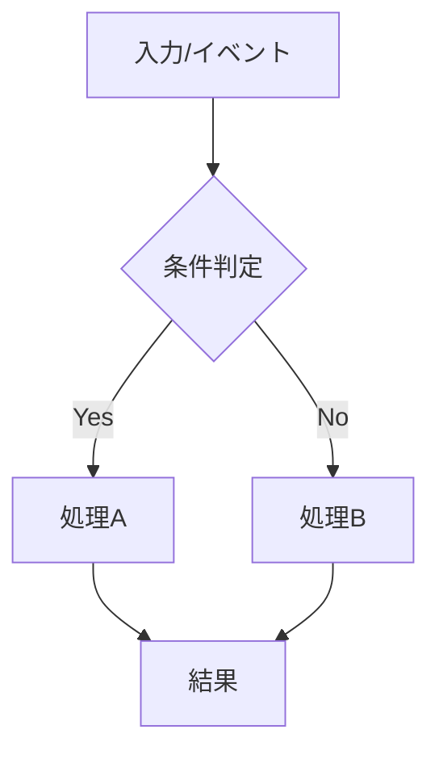

# 要件定義書

## 背景と目的

[機能の背景、目的、ユーザーに提供する価値を簡潔に記載]

## プロダクト方針との整合

[この機能が `product.md` の目標や原則にどう貢献するかを記載]

## 用語

- この仕様で使う概念を、`docs/reference/glossary.md` と同じ列で書く。新規の機能では必須とする
- 「用語集」列は、用語集に無い語を `新規`、意味や書き方を変える語を `変更`、そのまま使う語を `既存` とする
- `新規` / `変更` の行は、実装と同じ PR で用語集に足す（tasks の最終タスク）
- 新しい概念が無いときも表を消さず、「なし（既存の語だけを使う）」と書く
- 日本語の本文やコメントでは「UI」列の語を使う。「使わない語・区別」の語で書かない

| 用語 | UI | 意味 | 書き方 | 使わない語・区別 | 用語集 |
| --- | --- | --- | --- | --- | --- |
| [概念名] | [日本語の UI 文言。無ければ —] | [意味] | [API・YAML・DB・コードでの表記] | [同じ意味で使わない語、紛らわしい別の概念] | [新規 / 変更 / 既存] |

## 機能要件

### 要件1

**ユーザーストーリー:** [役割]として、[機能]をしたい。なぜなら、[価値/便益]を得たいから。

#### 受け入れ基準（要件1）

| No | アクター | きっかけ（ユースケース） | 期待される結果 |
| --- | --- | --- | --- |
| 1 | [役割] | [きっかけ] | [期待動作] |
| 2 | [役割] | [きっかけ] | [期待動作] |
| 3 | [役割] | [きっかけ] | [期待動作] |

### 要件2

**ユーザーストーリー:** [役割]として、[機能]をしたい。なぜなら、[価値/便益]を得たいから。

#### 受け入れ基準（要件2）

| No | アクター | きっかけ（ユースケース） | 期待される結果 |
| --- | --- | --- | --- |
| 1 | [役割] | [きっかけ] | [期待動作] |
| 2 | [役割] | [きっかけ] | [期待動作] |

## フロー図の記載方針（重要）

- 仕様が複雑な場合は、文章だけでなく**処理の具体的な流れが分かる図**を必ず記載する
- 特に以下に該当する場合は図の記載を必須とする
  - 条件分岐が多い
  - 非同期処理や外部連携がある
  - 例外系やリトライを含む
  - 状態遷移がある
- 図は `mermaid` のフローチャートまたはシーケンス図を推奨する

## 図表の追加方針（必要時）

- フロー図だけでは判断材料が不足する場合、以下の図表を追加する
- 追加した図表は、対応する要件番号（要件1/要件2など）を明記してトレース可能にする

### 追加候補

- **ユースケース図**: アクターと機能責務を俯瞰したい場合
- **業務フロー図**: 運用手順や承認ステップを明確にしたい場合
- **状態遷移図**: ステータス遷移ルールを定義したい場合
- **モデル図/ER図**: データ構造変更が要件成否に影響する場合
- **入力制約一覧表**: 項目別の文字数・文字種・禁止文字と根拠を示す場合

## 非機能要件

### コード構成とモジュール性

- **単一責任**: 1ファイル1責務を意識し、目的を明確にする
- **モジュール設計**: コンポーネント/ユーティリティ/サービスを分離し再利用可能にする
- **依存関係管理**: モジュール間の過剰な相互依存を避ける
- **インターフェースの明確化**: レイヤー間の契約を明文化する

### パフォーマンス

- [性能要件]

### セキュリティ

- [セキュリティ要件]

### 信頼性

- [信頼性要件]

### ユーザビリティ

- [使いやすさに関する要件]
