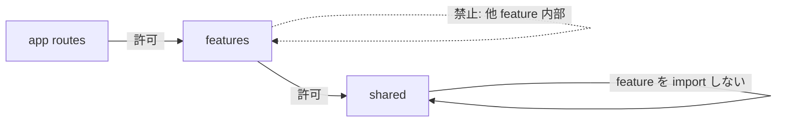

# UI Studio 内部構成（feature-first）

| 項目 | 値 |
| --- | --- |
| 種別 | Architecture |
| Version | 0.14 |
| 更新日 | 2026-11-15 |
| 関連 | [repository-layout.md](repository-layout.md), [development-guidelines.md](../development-guidelines.md), [ui-user-guide.md](../guides/ui-user-guide.md) |

**Version 0.14（2026-11-15）**: 全画面を `shared/ui` の部品で組む形にした（§8）。ボタンの色の役割（緑は主導線で 1 画面 1 つ、紺、枠線、赤枠）、部品の一覧、既定パレットの色の直書きを ESLint で禁止したこと、実行詳細のイベント送信の部品の分担を書いた。0.10 の「部品を使うのは集合配送ダイアログだけ」は廃止した。

**Version 0.13（2026-11-01）**: Project の文脈・ロール判定・所属一覧を `shared/project/` へ、`isApiNotFound` を `shared/api/` へ移した。feature 間の依存は公開面（`features/<name>/index.ts`）だけにし、他 feature の内部への import と、`@/app/*`・`@/tests/*` をアプリのコードで使うことを ESLint で禁止した。

**Version 0.12（2026-10-31）**: テストの配置の規則を追加した（`tests/` の下に、対象ソースの位置をそのまま映す）。テストが使うエイリアス `@/app/*`・`@/middleware`・`@/tests/*` を追加した。

**Version 0.11（2026-10-04）**: 画面の取得・検証・送信はフックがデータとコマンドで返す。`ReactNode` は返さない。loading / empty / error の出し分けは UI に残し、短い部品は行数だけで割らない。

**Version 0.10（2026-10-02）**: 画面の色クラスを `md-*` / `brand-*` へ寄せた。`Button` / `TextField` を使うのは集合配送ダイアログだけ。不透明度付きクラス、状態パレット、グラフとエディタの style 色は直書きのまま。

**Version 0.9（2026-10-02）**: 色トークンを Tailwind テーマ（`md-*` / `brand-*` / `editor-*`）へ写し、操作部品 `Button` / `TextField` を `shared/ui` に追加。適用済みは集合配送ダイアログのみ。

**Version 0.8（2026-07-26）**: Phase 5 完了（task 15）。最終ツリー・画面追加手順・Tailwind `content`・Docker ビルド注意を実装結果に合わせて確定。本移行は **Service API の HTTP 契約および利用者向け画面の振る舞いを変更しない**。

**Version 0.7（2026-07-26）**: Phase 5 task 14。旧 `app/lib` / `app/components` / `app/graphs` を削除。shell と `theme` を `shared` へ、グラフ定義を `features/executions/graphs` へ。i18n を feature 切片化し `shared/i18n/uiText*.ts` で合成。

**Version 0.6（2026-07-26）**: Phase 5 task 13。`features/admin` / `auth` / `dashboard` へ PageClient を移動。各 route は薄い wrapper。

**Version 0.5（2026-07-25）**: Phase 4 完了。`features/definition-editor`。内部アルゴリズムの書き換えなし。

**Version 0.4（2026-07-25）**: Phase 3 完了。`features/executions`。グラフ描画横断は `shared` へ。

---

Statevia Studio（`nodejs/studio/`）の**内部モジュール境界**の正本である。目的は所有権の明確化と、ページ増加時の変更影響の見通しである。

**契約・UX の非変更（必須）**: 本構成は配置と import 境界のみを対象とする。Service API の HTTP 契約（パス・クエリ・レスポンス形）および利用者向け画面の操作体験は変えない。契約の正本は [`../specifications/api-http.md`](../specifications/api-http.md) および各 UI 仕様である。

## 1. 最終ツリー

```text
nodejs/studio/
├─ app/                      # App Router のみ（薄い page / layout / route handlers）
│  ├─ api/                   # BFF（`/api/core/*`・auth）。移動しない
│  ├─ admin|dashboard|definitions|executions|login/
│  │  └─ **/page.tsx         # feature の画面を import するだけ
│  ├─ layout.tsx
│  └─ globals.css
├─ features/
│  ├─ definitions/           # api, hooks, ui, types, i18n
│  ├─ executions/            # api, hooks, lib, ui, types, graphs, i18n
│  ├─ definition-editor/     # ui, lib, actionSchema, types, i18n（巨大のため独立）
│  ├─ admin/                 # ui, types, i18n
│  ├─ auth/                  # ui, i18n
│  ├─ dashboard/             # ui, i18n
│  └─ projects/              # api, hooks, ui, types, i18n（Project 管理画面とメンバー）
├─ shared/
│  ├─ api/                   # transport + 共通 query 型
│  ├─ ui/                    # 画面の部品（§8）、AppShell・AppHeader・navigation/SideNav
│  ├─ i18n/                  # Context・locale・横断辞書 + feature 切片の合成
│  ├─ auth/                  # session / jwt ヘルパ
│  ├─ project/               # 選択中 Project の文脈（ProjectProvider / useProject）、ロール判定、所属一覧
│  └─ lib/                   # dateTime, errors, validation, theme, graphLayout
├─ tests/                    # 単体テスト。ソースの位置を映して置く（§5「テストの配置」）
├─ public/
├─ Dockerfile                # build 時に app / features / shared を COPY
└─ .dockerignore
```

旧 `app/lib` / `app/components` / `app/graphs` / `app/features` は削除済み。長期の互換 re-export は残さない。小規模 feature（admin / auth / dashboard）は必ずしも `api` / `hooks` 層を分けない。

## 2. パスエイリアス

| エイリアス | 実体 |
| --- | --- |
| `@/features/*` | `features/*` |
| `@/shared/*` | `shared/*` |
| `@/app/*` | `app/*`（テストだけが使う） |
| `@/middleware` | `middleware.ts`（テストだけが使う） |
| `@/tests/*` | `tests/*`（テストだけが使う。`testUtils`・`helpers/`・`mocks/`） |

エイリアスは `tsconfig.json` の `paths` と `vitest.config.ts` の `resolve.alias` に揃えて書く。アプリのコードは `@/app/*` と `@/tests/*` を使わない。route から feature を参照する。

## 3. 依存方向（必須）



| 向き | 可否 |
| --- | --- |
| `app` → `features` | 許可 |
| `features` → `shared` | 許可 |
| `shared` → `features` | **禁止**（例外: `shared/i18n/uiText*.ts` が feature の i18n 切片を合成 import する） |
| feature → 他 feature の公開面（`features/<name>/index.ts`） | 許可（他 feature が使うものだけを index から export する） |
| feature → 他 feature の内部 | **禁止**（アプリ全体で使うものは `shared` へ上げる。feature 固有の機能は公開面から使う） |

機械チェック: `nodejs/studio/eslint.config.js` の `no-restricted-imports` で次を error にする。

- `shared/**` から `@/features` / `features` への import（`shared/i18n/uiText.ts` / `uiText.en.ts` のみ辞書合成のため除外）。
- `features/<a>/**` から他 feature の内部（`@/features/<b>/...`。`b ≠ a`）への import。公開面 `@/features/<b>` は許す。feature の一覧は `features/` 直下のディレクトリから作るため、feature を足すとルールも足される。
- `features/**` で feature の外へ出る相対 import（2 段以上上る `../../`、feature 直下のファイルの `../`）。feature 内の相対 import は 1 段上まで、それより遠いものはエイリアスで書く。
- アプリのコード（`app` / `features` / `shared` / `middleware.ts`）での `@/app/*` と `@/tests/*`（テスト専用のエイリアス）。

`app` から `features` への import は、公開面に限らず許す（route が feature の画面を直接 import するため）。

## 4. feature 内の標準レイヤ

| 層 | 置き場 | 例 |
| --- | --- | --- |
| API client | `features/*/api.ts` | `listDefinitions`, `softDeleteDefinition` |
| hooks | `features/*/hooks/` | URL 同期、一覧取得、delete/restore |
| UI | `features/*/ui/` | 一覧行、確認ボタン群、PageClient |
| i18n | `features/*/i18n/` | 画面文言切片（`shared/i18n` で合成） |
| route | `app/**/page.tsx` | feature の Page を返すだけ（`"use client"` は feature 側） |

### 画面のフックと UI

長い画面では、取得・検証・送信を `features/<name>/hooks/` のフックへ置く。画面コンポーネントはフックを 1 回呼び、レイアウトを返す。

| 置くもの | 置き場 |
| --- | --- |
| 状態、`useEffect`、API 呼び出し、ハンドラ | フックが返すデータとコマンド |
| その画面だけの導出 | フックと同じファイルの関数 |
| 複数画面で使う導出 | `features/<name>/lib/` |
| レイアウトと、loading / empty / error / ダイアログ閉止 | `features/<name>/ui/` |
| 文言 | 既存の i18n 辞書 |

フックの戻り値はフラグ、文言、配列、コールバックである。`ReactNode` や描画済みのノードは返さない。

部品だけの操作（候補リストの開閉、入力欄の下書き）は、その表示コンポーネントの state に残す。フィルタ、一覧、フォーム、ダイアログのように、骨格を名前で追える塊だけを表示コンポーネントにする。短いマークアップや、すでにフックへ出ている画面を、行数だけを理由に割らない。ページングのように既存の共有部品があるものは、ページの JSX からそれを使う。

分割の前後で HTTP と画面の操作結果は変えない。

## 5. 画面追加の手順

1. `features/<name>/` に必要な層（`api` / `hooks` / `ui` / `types` / `i18n`）を置く。
2. `app/**/page.tsx` は薄い wrapper のみにする（表示・ロジックは feature 側）。
3. 横断関心のみ `shared/` に置く（ドメイン知識を `shared` に落とさない）。
4. 文言を追加する場合は feature の i18n 切片を更新し、`shared/i18n/uiText*.ts` の合成を維持する。
5. Tailwind CSS 4 はクラスをソースから自動検出する。`features` / `shared` のクラスは、Dockerfile がそれらのディレクトリを COPY していれば本番 CSS に含まれる。
6. `npm run lint` / `typecheck` / `test:run` を通す。テストは次の「テストの配置」に従って置く。
7. Docker イメージを使う場合は `nodejs/studio/Dockerfile` が `features` / `shared` を COPY していること、および再ビルドを前提にする。

### テストの配置

単体テスト（Vitest）は `tests/` の下に、対象ソースの位置をそのまま映して置く。テストの置き場所は、対象ソースの位置から一意に決まる。

| 対象ソース | テストの置き場所 |
| --- | --- |
| `features/<name>/<path>/X.ts(x)` | `tests/features/<name>/<path>/X.test.ts(x)` |
| `shared/<area>/<path>/X.ts(x)` | `tests/shared/<area>/<path>/X.test.ts(x)` |
| `app/<route>/page.tsx`・`route.ts`・`layout.tsx` | `tests/app/<route>/`（`[definitionId]` などの動的セグメントもそのまま映す） |
| `middleware.ts` | `tests/middleware.test.ts` |

- 1 つのモジュールの一部の関数だけを確かめるテストは、関数名をファイル名にしてよい（例: `features/executions/hooks/useGraphData.ts` の `getNodeWithFallback` → `tests/features/executions/hooks/getNodeWithFallback.test.ts`）。置き場所は対象モジュールのディレクトリに従う。
- 複数のソースにまたがるテストは、それらに共通する最も近いディレクトリに置く（例: 複数のページのスモーク → `tests/app/pages.smoke.test.tsx`）。
- テストから `tests/` の外のソースとテスト用ヘルパーを import するときは、相対パスではなくエイリアス（§2）を使う。同じディレクトリに置くテスト専用の補助ファイルだけは `./` で import してよい。
- テスト用の共通部品は、`tests/testUtils.tsx`・`tests/helpers/`・`tests/mocks/`・`tests/setup.ts` に置く。
- E2E（Playwright）は `e2e/` に置き、この規則の対象外とする。

## 6. 段階移行チェックリスト

| Phase | 内容 | 完了条件 |
| --- | --- | --- |
| 0 | 本正本・paths・骨格・依存方向チェック | lint / typecheck / test:run（完了） |
| 1 | transport / UI primitive / i18n・auth・汎用 lib を `shared` へ | 同上。長期 re-export なし（完了） |
| 2 | `features/definitions` パイロット（api / hooks / ui / i18n） | 定義一覧・詳細の既存テスト通過（完了） |
| 3 | `features/executions`（必要なら graph） | 実行画面・関連テスト（完了） |
| 4 | `features/definition-editor`（移動と境界のみ） | 編集画面の挙動非変更（完了） |
| 5 | admin / auth / dashboard、旧ディレクトリ削除、docs 最終反映 | **完了**（task 13–15） |

### PR レビュー必須項目（依存方向）

- [ ] `shared` から `features` への import が無い（ESLint で検知。i18n 合成の除外ファイル以外）
- [ ] feature が他 feature の内部パスを import していない（ESLint で検知。公開面 `index.ts` に足した export は、他 feature が使うものだけか）
- [ ] `app/**/page.tsx` が肥大化していない（表示・ロジックは feature 側）
- [ ] 一時 re-export を残す場合は同一 Phase 内で解消する方針が PR に書かれている
- [ ] HTTP 契約・利用者向け振る舞いを意図せず変えていない

## 7. 非目標

- 機能追加、HTTP 契約変更、見た目の再デザイン
- `DefinitionGraphEditor` 内部アルゴリズムの大規模書き換え
- データ取得の全面 Server Components 化（規則の文書化は可）
- C# Clean Architecture フォルダ名のそのまま移植
- React Query 等の新規状態管理ライブラリ導入

## 8. 色トークンと部品

### 8.1 色トークン

色の正本は `app/globals.css` の CSS 変数である。Tailwind のユーティリティへは、同じファイルの `@theme` が写す。ライトとダークの値はどちらも `globals.css` に置き、`dark:` はアプリのテーマ（`@custom-variant dark`）に従う。

| 変数の接頭辞 | 用途 | ユーティリティの例 |
| --- | --- | --- |
| `--md-sys-color-*` | 面・文字・枠・状態の色 | `text-md-on-surface`、`bg-md-surface`、`border-md-outline`、`text-md-error` |
| `--brand-lead-*` | 主導線（緑）のボタン | `bg-brand-lead-bg`、`text-brand-lead-fg` |
| `--brand-cta-*` | 通常の操作（紺）のボタン。ダークは青を敷いた淡い塗り | `bg-brand-cta-bg`、`text-brand-cta-fg` |
| `--nav-item-active-*` | サイドメニューの選択中の項目 | `bg-nav-item-active-bg` |
| `--radius-*` | 角丸（`control` 6px・`card` 12px・`pill`） | `rounded-control`、`rounded-card`、`rounded-pill` |
| `--editor-*` | コードエディタ | `text-editor-caret` |

`md` 接頭辞は、Tailwind 既定の `neutral` パレットを置き換えないためである。新規の色指定で `text-[var(--md-sys-color-on-surface)]` は使わない。

`features/**` と `shared/**` では、Tailwind の既定パレットの色（`bg-gray-100`・`text-red-600`・`border-amber-200` など）を書かない。`eslint.config.js` の `no-restricted-syntax`（`paletteColorClassPattern`）が文字列とテンプレートの両方を error にする。除外の一覧は持たない。`app/**` は route の薄い殻で色を持たないので対象外である。

### 8.2 ボタンの色の役割

`shared/ui/Button` の `variant` は役割で選ぶ。`next/link` をボタンの見た目にするときは `buttonClassName(variant, size)` を使う。

| variant | 色 | 使う場面 |
| --- | --- | --- |
| `lead` | 緑 | 主導線。1 画面に 1 つまで。ページの見出しの右か、フォームの下の操作バーに置く |
| `standard` | 紺 | 主導線以外の操作（イベントを送信・このノードへ送る・検索など） |
| `outline` | 枠線 | 補助（キャンセル・読み込み・全画面・行の中の操作） |
| `danger` | 赤枠 | 削除・実行のキャンセル・失効など取り消しにくい操作の入口 |
| `dangerSolid` | 赤の塗り | 確認ダイアログの確定だけ |
| `ghost` | 塗り無し | 文字だけの軽い操作 |

`size` は `md`（既定）、`sm`（一覧の行の中だけ）、`icon`（アイコンだけ。`aria-label` 必須）。

ダイアログは画面とは別の層なので、ダイアログの確定に `lead` を使ってよい（画面の見出しの `lead` と数えない）。

### 8.3 部品の一覧

| 部品 | 用途 |
| --- | --- |
| `PageShell` | パンくず → 見出し（と右の操作）→ 本文 → 下部の操作バー、の骨格 |
| `Breadcrumbs` | 深い階層の画面で上へ戻る導線 |
| `Card` | 見出し・説明・右上の操作・本文の枠 |
| `Notice` | 情報・成功・注意・エラーのお知らせ（エラーは `role="alert"`） |
| `PageState` / `EmptyState` / `TableSkeleton` | 読み込み中・失敗・空の表示 |
| `Toast` | 操作の結果の一時的な通知 |
| `Dialog` | ポップアップダイアログ（暗幕・Esc・フォーカスの閉じ込め） |
| `ConfirmDialog` | 確認。取り消しにくさが大きい削除は `requireTypedName` で名前の入力を求める（今は定義の削除だけ） |
| `TextField` / `SelectField` / `TextAreaField` | ラベル・説明・エラー付きの入力。ラベルの無い入力（検索欄など）は `inputClassName` |
| `FormField`（`FieldLabel` / `FieldMessage` / `inputClassName`） | 入力の共通部分。`inputClassName` は横の余白と枠の色を 1 つずつ選ぶ（Tailwind は同じ性質のクラスを CSS の順で決めるため、`px-3` と `pl-9` を重ねない） |
| `DataList` | 一覧。デスクトップは表、狭い幅はカード。列幅は `width` で揃える |
| `FilterPills` | 一覧の単一選択の絞り込み（件数付き） |
| `FilterChips` | かけている条件のチップ。1 つずつ外す・すべて外す |
| `SegmentedControl` | 表示の切り替え（一覧 / グラフなど） |
| `ListPagination` | ページ移動 |
| `StatusBadge` / `StatusDot` | 状態の表示。待機中のときは `ACTIVE` の横に「待機中」の印を足す（状態の値は増やさない） |
| `BrandMark` | ロゴのマーク |

行そのものを押す操作（タイムラインの行・ノードの選択・比較の差分の行など）は `Button` の形に合わないので、生の `<button>` のまま色だけトークンにする。

次はトークンの色を `style` か不透明度付きのクラスで書いたまま残す。

- グラフノードの帯、凡例、フォーク領域などの不透明度付きのクラス
- グラフのエッジとコードエディタの caret / プレースホルダ（`style`。クラスではない）

### 8.4 実行詳細のイベント送信

実行詳細（`features/executions`）では、待機中の実行へイベントを届ける操作を次のように分ける。HTTP は `POST /v1/executions/{id}/nodes/{nodeId}/resume` と `POST /v1/executions/{id}/events` で、Studio はどちらも変えない。

| 置き場 | 役割 |
| --- | --- |
| `ui/ExecutionHeader` | 見出しの右に「キャンセル」（`danger`）・「比較」（`outline`）・「イベントを送信」（`lead`。待機があり送れるときだけ） |
| `ui/ExecutionWaitNotice` | 見出しの下の待機のお知らせ。待機が 2 つ以上なら行ごとに「このイベントを送る」 |
| `ui/SendEventDialog` | 届け先（待っているノード、またはイベント名を指定して実行へ）を選んで送る。失敗してもダイアログを閉じずにエラーを中に出す |
| `ui/NodeDetail`・`ui/NodeGraphView` | 待機中のノードの「このノードへ送る」。そのノードを選んだ状態でダイアログを開く |
| `hooks/useSendEvent` | 2 つの API の呼び分け。失敗はトーストではなく戻り値の文言で返す |
| `lib/waitTargets` | 実行のノードから届け先の候補（待機）を作る |

操作は `executions.write` があるときだけ出す（認可の正本は Service API）。イベント名で送るときは、当てはまる待機が 1 つのときだけ届く。0 件や複数のときは Service API が受け付けない。
